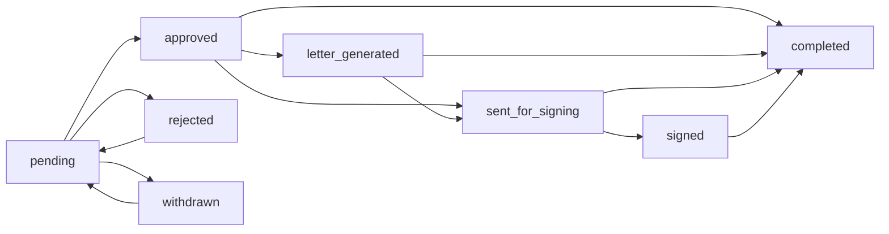

# Bridge

[](https://aaryan-mk7.github.io/Bridge/)

**[Open the public project preview →](https://aaryan-mk7.github.io/Bridge/)**

Bridge is an internal employee-letter workflow for collecting structured requests, generating documents, routing decisions through HR, and optionally sending approved letters through DocuSign. It provides separate employee and administrator workspaces backed by one authenticated Express API and MongoDB.

## What Bridge does

Employees can:

- Sign in with an employee ID and password.
- Submit a request from a built-in or administrator-defined letter type.
- Supply dynamic request fields, a letter address, and additional context.
- Track status history, download approved letters, withdraw pending requests, and resubmit rejected or withdrawn requests.
- Maintain their contact details and change their password.
- Request a one-time password reset link when email delivery is configured.

Administrators can:

- Review the organization-wide request queue and record approval or rejection notes.
- Download generated documents and send approved requests to DocuSign.
- Create employees with a temporary password, import employee records from CSV, and manage roles.
- Define the active letter types and dynamic text, number, date, or email fields accepted by the API.
- Configure the operations notification address and inspect EmailJS readiness.
- Connect and inspect the optional DocuSign integration.

## Request lifecycle

Bridge enforces request changes with a server-side state machine:



Employees own their requests, can withdraw only pending work, and can resubmit rejected or withdrawn work. Administrators control decisions and signing operations. Status-changing writes use conditional database updates so concurrent actions cannot silently overwrite one another. The API rejects unsupported or out-of-order transitions with `409 INVALID_STATUS_TRANSITION`.

## Architecture

Bridge is an npm-workspace monorepo:

```text
Bridge/
├── client/                    React 19 and Vite single-page application
│   └── src/
│       ├── api/               Central fetch transport and resource clients
│       ├── auth/              Session context and route guards
│       ├── components/        Shared layout and UI primitives
│       ├── config/            Browser runtime configuration
│       ├── features/
│       │   ├── admin/         Requests, people, templates, settings, integrations
│       │   ├── auth/          Login and password-reset screens
│       │   ├── employee/      Overview, submission, history, and profile
│       │   └── shared/        Shared route-level screens
│       └── lib/               Contracts, formatting, and unit tests
├── server/                    Express 5 API
│   ├── config/                Validated runtime configuration
│   ├── domain/                Safe DTOs and request-state rules
│   ├── middleware/            Bearer authentication and error normalization
│   ├── models/                Mongoose persistence models
│   ├── routes/                Resource-oriented API routers
│   ├── scripts/               Admin bootstrap and live smoke harness
│   ├── services/              JWT, email, documents, and DocuSign
│   ├── test/                  Deterministic server tests
│   ├── app.js                 Injectable application composition
│   ├── database.js            Connection and default-template seeding
│   └── index.js               Process startup and graceful shutdown
├── public/templates/          Optional organization-owned DOCX templates
└── package.json               Root workspace commands
```

### Client boundaries

`client/src/api/client.js` owns the base URL, bearer header, response parsing, file downloads, and unauthorized-session handling. Feature screens call the resource methods in `client/src/api/resources.js` rather than building URLs directly.

`AuthProvider` restores the browser session, revalidates the current employee and role, supplies the in-memory bearer token, and clears the session on authenticated `401` responses. React Router guards separate guest, employee, and administrator routes. The client guards improve navigation, while the API remains the authorization authority.

### Server boundaries

`server/app.js` creates an application from injected models and services. It does not open a database connection or listen on a port, which keeps route and health behavior deterministic in tests. `server/index.js` validates configuration, connects MongoDB, starts HTTP, and handles shutdown.

MongoDB is the live source of truth. CSV is an explicit administrator import format, not a second datastore. Generated document paths and provider details stay on the server and are filtered from public DTOs.

## Data model

### Employee

Stores the immutable employee identifier, profile fields, role, bcrypt password hash, and optional password-reset state. Authentication fields use Mongoose `select: false` and are stripped again by the employee DTO.

Roles are:

- `user` — employee workspace and self-owned resources.
- `admin` — administrator workspace and organization-wide resources.

### LetterTemplate

Defines the user-facing label, stable value, optional reference URL, active flag, and dynamic fields. Field types are `text`, `number`, `date`, and `email`; each field retains its `required` setting. Only active database templates can be submitted, and the API rejects missing, undeclared, or incorrectly typed dynamic fields.

### LetterRequest

Captures the server-derived employee identity, letter type, sanitized dynamic details, address, comments, current status, decision metadata, generated-document metadata, and optional DocuSign envelope metadata.

### Setting

Stores small operational settings. The current `notifications` record contains only the operations notification email. EmailJS credentials are environment configuration and are never stored through the browser.

## Authentication and security model

- Login returns a signed JWT containing a minimal subject and employee ID claim.
- Authenticated requests use `Authorization: Bearer <token>`; cookies and credentialed CORS are not used.
- Every authenticated request verifies the token and reloads the employee, so deleted accounts and role changes take effect immediately.
- Passwords are hashed with bcrypt at cost 12.
- Public login and password-recovery endpoints are throttled per client address.
- Helmet applies defensive HTTP response headers.
- Password-reset tokens are random, stored only as SHA-256 hashes, expire after one hour, and are never returned by the API.
- Employee, request, template, settings, and DocuSign resources are protected.
- Self-or-admin middleware prevents employees from reading another employee's profile or request history.
- Request ownership is checked for document access, withdrawal, and resubmission; employees cannot download or preview a document until approval.
- Administrator-only middleware protects organization-wide lists, decisions, employee management, settings, and integrations.
- CORS accepts only configured frontend origins.
- Input utilities bound string lengths, reject nested request-detail objects, validate emails and object IDs, and constrain uploads.
- CSV imports are memory-only, limited to 2 MiB and 5,000 rows, and accept CSV MIME types plus a `.csv` extension.
- API errors use a stable `{ "error": { "code", "message", "details?" } }` envelope.

The web client currently persists the JWT in `localStorage`. Production deployments should use a restrictive Content Security Policy, avoid untrusted scripts, and treat any XSS as credential exposure. Password changes and resets revoke existing tokens through an account authentication version; otherwise tokens remain valid until `JWT_EXPIRES_IN`. The default rate-limit store is process-local, so multi-replica deployments require a shared store to enforce global limits.

## API overview

Public process and authentication routes:

- `GET /` — basic API response.
- `GET /health` — database-aware health response.
- `POST /api/employees/login`
- `POST /api/employees/forgot-password`
- `POST /api/employees/reset-password`
- `GET /api/docusign/callback` — validates one-time OAuth state before exchanging a provider code.
- `POST /api/docusign/ping` — empty provider health response.

Authenticated employee resources:

- `/api/employees` — profiles, password changes, and administrator-managed directory operations.
- `/api/letter-requests` — create, list, decide, withdraw, resubmit, download, preview, and sign requests.
- `/api/templates` — active request definitions; mutations require an administrator.

Administrator resources:

- `/api/settings/notifications`
- `/api/docusign/auth`, `/status`, read-only `/templates` and `/envelopes`, and `/logout`

See the route modules in `server/routes/` for exact payloads and provider-specific operations.

## Local setup

### Prerequisites

- Node.js 20 or newer
- npm with workspace support
- MongoDB available locally or through a reachable connection string
- `mongod` on `PATH` only when running the live smoke test

### Install

```bash
git clone https://github.com/Aaryan-MK7/Bridge.git
cd Bridge
npm install
cp client/.env.example client/.env
cp server/.env.example server/.env
```

### Configure the client

`client/.env` supports:

- `VITE_API_URL` — API origin; defaults to `http://localhost:4000`.

Only variables prefixed with `VITE_` are exposed to browser code. Do not put server credentials in the client environment.

### Configure the server

Required or core values in `server/.env`:

- `PORT` — API port; defaults to `4000`.
- `MONGO_URI` — MongoDB connection URI.
- `FRONTEND_ORIGIN` — comma-separated CORS allowlist.
- `FRONTEND_URL` — canonical SPA origin used for reset and provider return URLs.
- `JWT_SECRET` — at least 32 characters; the development placeholder is rejected in production.
- `JWT_EXPIRES_IN` — duration such as `30m`, `8h`, or `7d`.

Optional email values:

- `ADMIN_EMAIL` — fallback new-request recipient when no database setting exists.
- `EMAILJS_SERVICE_ID`
- `EMAILJS_TEMPLATE_ID`
- `EMAILJS_PUBLIC_KEY`
- `EMAILJS_USER_ID` — optional; defaults to the public key.

Optional DocuSign values:

- `DOCUSIGN_CLIENT_ID`
- `DOCUSIGN_USER_ID`
- `DOCUSIGN_PRIVATE_KEY`
- `DOCUSIGN_CLIENT_SECRET`
- `DOCUSIGN_ACCOUNT_ID`
- `DOCUSIGN_REDIRECT_URI` — normally `http://localhost:4000/api/docusign/callback` locally.
- `DOCUSIGN_OAUTH_BASE` — defaults to the DocuSign demo identity host in the example.

Never commit `.env`, private keys, generated documents, database files, or employee exports.

### Create the first administrator

Set these temporary bootstrap values in `server/.env`:

- `ADMIN_EMPLOYEE_ID`
- `ADMIN_NAME`
- `ADMIN_ACCOUNT_EMAIL`
- `ADMIN_PASSWORD` — at least eight characters

Then run:

```bash
npm run bootstrap:admin --workspace=server
```

The command creates or updates the named administrator and hashes the supplied password. Remove `ADMIN_PASSWORD` from the environment after bootstrap. Running the command again intentionally updates that administrator's profile and password and revokes older sessions.

### Start development

Run the API and SPA in separate terminals:

```bash
npm run start:server
```

```bash
npm run start:client
```

Open `http://localhost:5173`. Vite serves the client and the API listens on `http://localhost:4000` by default.

## Employee onboarding and CSV import

Manual creation requires a temporary password, so the new employee can sign in immediately.

CSV import recognizes:

- `Employee ID` or `employeeId`
- `Employee` or `name`
- `Start date` or `startDate`
- `Title` or `title`
- `Home address - Full address` or `address`
- `Email` or `email`

Imported records deliberately do not accept plaintext passwords. An imported employee must use the forgot-password flow with a configured email service. Use manual onboarding instead of CSV when an employee needs an immediate temporary password.

## Document generation

On submission, Bridge attempts to generate a DOCX and stores it under `server/generated-letters/`, which is ignored by Git.

For organization-branded documents, place templates in `public/templates/`. Known letter types map to the filenames in `server/services/letterGeneratorService.js`; a custom type can use `<template-value>.docx`. DOCX templates may use aliases such as:

- `EMPLOYEE_NAME`, `employee_name`, or `EmployeeName`
- `EMPLOYEE_ID`, `employee_id`, or `EmployeeID`
- `REQUEST_DATE`
- `LETTER_TYPE`
- `ADDRESS`, `address`, or `Address`
- `ADDITIONAL_DETAILS`
- `EMPLOYEE_COMMENTS`

If a DOCX template is absent or cannot be rendered, Bridge creates a valid generic DOCX instead. A request is still saved if document generation itself fails; the create response includes a warning so the workflow does not lose submitted data.

## Email notifications

Email is sent from the server through the EmailJS REST API. The database setting controls the operations recipient, while service credentials remain in environment variables.

Notifications are best effort:

- A new request can notify the configured operations address.
- Approval and rejection can notify an employee with a saved email address.
- Forgot-password delivery uses the same service.
- Request persistence and decisions are not rolled back when an optional email call fails.

The administrator settings screen reports whether the service ID, template ID, and public key are present without exposing their values.

## DocuSign

DocuSign supports JWT authentication with OAuth fallback and one-time state validation. The administrator integrations screen owns connection status. Approved or generated requests can be sent as embedded-signing envelopes. Sent requests expose controls to resume embedded signing and refresh the provider status; completed envelopes update the Bridge request.

Important operational constraints:

- Configure the provider redirect URI to the API callback, not the SPA.
- The OAuth and access-token registry is in process memory. Restarting the API disconnects active integrations.
- Multiple API replicas do not share provider sessions. Use a shared encrypted token store before horizontally scaling DocuSign workloads.
- DocuSign is optional; an unavailable provider does not undo an approval decision.

## Validation

Run the complete deterministic validation pipeline:

```bash
npm run check
```

It runs:

1. Strict client ESLint, including React Hooks and unused-variable checks.
2. Client contract tests.
3. Server configuration, security, state-machine, document, validation, and health tests.
4. The production Vite build.

Check production dependency exposure separately:

```bash
npm audit --omit=dev
```

Run the isolated real-database smoke workflow:

```bash
npm run smoke:live --workspace=server
```

The smoke harness:

- Starts `mongod` on an available loopback port with a temporary data directory.
- Generates random bootstrap and employee passwords without printing them.
- Runs the real administrator bootstrap command.
- Verifies JWT login, protected routes, manual employee creation, and employee login.
- Verifies self access and cross-employee denial.
- Verifies active-template enforcement and rejection of undeclared request fields.
- Creates and lists requests against MongoDB, including address persistence and pending-document denial.
- Verifies administrator document access, approval, and post-approval employee download.
- Verifies owner-only withdrawal and rejected/withdrawn resubmission rules.
- Verifies current-password checking and revocation of an older JWT after a password change.
- Stops MongoDB and removes its temporary data.

Set `MONGOD_BINARY` when the executable is not available as `mongod`.

## Health and error behavior

`GET /health` returns:

- `200` with `status: "ok"` when MongoDB is connected.
- `503` with `status: "degraded"` when the process is running but persistence is unavailable.

Startup fails before listening when the runtime configuration is invalid or MongoDB cannot connect. Unexpected API errors are logged server-side while clients receive a generic `INTERNAL_ERROR` response.

## Production deployment

1. Build the client with `npm run build`; deploy `client/dist/` behind an HTTPS static host with SPA fallback to `index.html`.
2. Run the server with `NODE_ENV=production` and a non-default JWT secret.
3. Set `FRONTEND_ORIGIN` to the exact HTTPS client origin and `FRONTEND_URL` to the same canonical application URL.
4. Use a managed MongoDB deployment with backups and network controls.
5. Mount persistent storage for `server/generated-letters/`, or replace local document storage with object storage before running multiple API replicas.
6. Keep environment secrets and DocuSign private keys in a secret manager.
7. Route liveness/readiness checks to `/health`.
8. Terminate TLS before the client and API and add security headers, especially a restrictive Content Security Policy.
9. Replace the in-memory login/recovery rate-limit store with a shared store before running multiple API replicas.

## Troubleshooting

### The API reports degraded health

Confirm `MONGO_URI`, MongoDB network access, and database credentials. Bridge intentionally reports `503` until Mongoose is connected.

### The browser reports a CORS error

Add the exact browser origin, including scheme and port, to `FRONTEND_ORIGIN`. Separate multiple allowed origins with commas.

### Login always fails

Confirm the employee has a password hash. Manual creation and the bootstrap command set one; CSV import does not. Also verify that the employee ID matches exactly.

### A request exists but no branded document was produced

Check the server log and template filename. Bridge falls back to a generic DOCX when possible. Generated output belongs in `server/generated-letters/`, never in `public/templates/`.

### Email settings look ready but mail is not delivered

Confirm the EmailJS service, template, public key, recipient, provider permissions, and template parameter names. Email failures are intentionally non-transactional.

### DocuSign redirects or signing fails

Verify the integration is connected, the API callback matches `DOCUSIGN_REDIRECT_URI`, the administrator has an email address, and the request has a generated document. Reconnect after an API restart because provider sessions are in memory.
